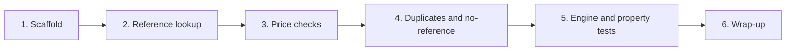

# Implementation Plan: /core checks engine (v1)

## Overview

Build the deterministic checks engine in small steps: scaffold, code lookup, then each check,
then the engine and property tests. Each task is small and ends with a two-sentence summary and
what to test. Do one or two tasks at a time.

Requirements are in `requirements.md` (R1 to R11). Test cases (TC-*) and properties (PR*) are
in `design.md`.

## Tasks

- [x] 1. Scaffold and dev tooling
  - Create `core/` package with `constants.py` (MEDICARE_MULTIPLE, severities, BANNED_WORDS).
  - Add `requirements-dev.txt` (`pytest`, `hypothesis`) and `pytest.ini` (`pythonpath = .`).
  - Smoke test that `from core import analyze` works and `analyze([], [])` returns `[]`.
  - _Requirements: R1, R2. Tests: TC-E1_

- [x] 2. Language and reference lookup
  - `language.py`: money formatter. (Flag templates move to task 3, where they are first used.)
  - `reference.py`: code normalization/sanitizer, index and lookup rules.
  - Unit tests TC-L1 to TC-L12.
  - _Requirements: R8, R9_

- [x] 3. Price checks
  - `to_money` (Decimal conversion) and the price flag templates in `language.py`.
  - `checks/price.py` with both flags and per-unit logic.
  - Unit tests TC-P1 to TC-P14.
  - _Requirements: R3, R4, R5_

- [x] 4. Duplicates and no-reference
  - `checks/duplicates.py`, `checks/coverage.py`, and their templates in `language.py`.
  - Unit tests TC-D1 to TC-D8, TC-N1 to TC-N4.
  - _Requirements: R6, R7_

- [x] 5. Engine and property tests
  - `engine.py` runs the checks and sorts output.
  - Unit tests TC-E2, TC-E3. Hypothesis tests PR1 to PR11.
  - _Requirements: R2, R10_

- [x] 6. Wrap-up
  - Append a line to `docs/kiro-log.md`. Confirm no file I/O or network imports in `core/`.

## Task Dependency Graph

Tasks 3 and 4 both edit `language.py`, so they run one after the other, not in parallel.



Execution waves. Each wave needs the one before it: task 2 needs the package from task 1, tasks 3
and 4 need the lookup from task 2, task 5 needs all checks, and task 6 needs task 5.

```json
{
  "waves": [
    { "id": 0, "tasks": ["1"] },
    { "id": 1, "tasks": ["2"] },
    { "id": 2, "tasks": ["3"] },
    { "id": 3, "tasks": ["4"] },
    { "id": 4, "tasks": ["5"] },
    { "id": 5, "tasks": ["6"] }
  ]
}
```

## Notes

- `/core` stays pure: no network, no file reads or writes, no randomness, no LLM.
- Types come from `/contracts` and are never redefined.
- Reference test data is synthetic (`data_source="synthetic-test"`) and never real.
- `MEDICARE_MULTIPLE` is a placeholder to tune once real data is seen.
- Open question: `Flag.explanation` (see the Open item in `design.md`). It does not change `/core`.
- Deferred: `quantity_implausible` and `possible_unbundling` (see Out of scope in `design.md`).
- Do not commit anything from `/private`. Work on a branch and open a PR into `main`.
