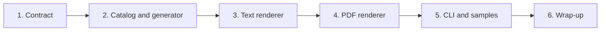

# Implementation Plan: Synthetic bill generator

## Overview

Build the generator in small steps, merging each finished piece into `main`: the contract first so
Sam can read it, then the catalog and generator, then the renderers, then the CLI and samples.

Requirements are in `requirements.md`. Test cases (TS-*) and properties (PS*) are in `design.md`.

## Tasks

- [x] 1. Contract
  - Add `contracts/synthetic-bill.schema.json` (`BillMetadata`, `ExpectedFlag`, `SyntheticBill`).
  - Mirror it in `contracts/types.ts` and `contracts/types.py`; add a row to `contracts/README.md`.
  - Test TS-K1.
  - _Requirements: 5.1_

- [x] 2. Catalog and generator
  - `synthetic/catalog.py` with fictional procedures and reference prices.
  - `synthetic/generate.py` with `generate_bill`, `to_json`, all six scenarios.
  - Tests TS-G1 to TS-G14 and properties PS1 to PS4, PS6.
  - _Requirements: 1.1, 1.2, 1.3, 2.1, 2.2, 2.3, 2.4, 2.5, 3.1, 3.2, 3.3_

- [x] 3. Text renderer
  - `render_text` with `plain` and `messy` styles.
  - Tests TS-R1 to TS-R3.
  - _Requirements: 4.2, 4.3_

- [ ] 4. PDF renderer
  - `render_pdf` with a minimal stdlib PDF writer.
  - Tests TS-R4 to TS-R7 and property PS5.
  - _Requirements: 4.1, 4.4_

- [ ] 5. CLI and samples
  - `synthetic/__main__.py`, committed `synthetic/samples/`, short `synthetic/README.md`.
  - Tests TS-C1 to TS-C3.
  - _Requirements: 5.2, 5.3, 5.4_

- [ ] 6. Wrap-up
  - Append a line to `docs/kiro-log.md`; confirm no new dependencies.

## Task Dependency Graph

Task 2 needs the types from task 1. Tasks 3 and 4 both edit `synthetic/render.py`, so they run in order.



```json
{
  "waves": [
    { "id": 0, "tasks": ["1"] },
    { "id": 1, "tasks": ["2"] },
    { "id": 2, "tasks": ["3"] },
    { "id": 3, "tasks": ["4"] },
    { "id": 4, "tasks": ["5"] },
    { "id": 5, "tasks": ["6"] }
  ]
}
```

## Notes

- `/synthetic` is stdlib only. No new dependencies.
- No real people, hospitals, or prices. Reference data is labelled `synthetic-demo`.
- The `injection` scenario deliberately contains banned words as test data. Its source file carries
  `language-guard: allow`.
- Ground truth is built by construction and is never computed by calling `/core`.
- Merge each finished piece into `main` after pulling `main` and running the full test suite.
